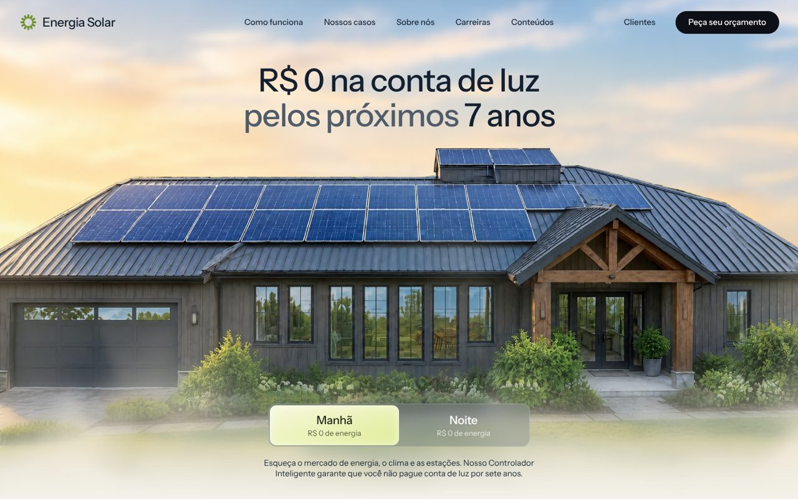
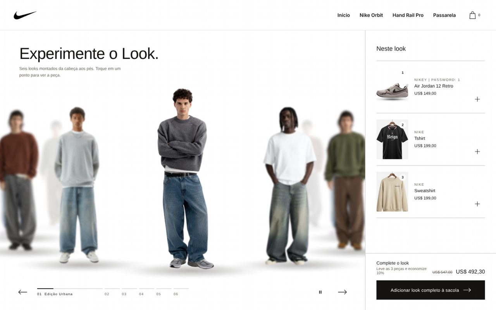

# Lucas Gabriel

**Desenvolvedor front end**

Interfaces web em React e TypeScript e sites para negócios locais. 
Anápolis, GO · Engenharia de Software na UniEVANGÉLICA

 

---

## Sobre

Trabalho com front end: interface, componentes, responsividade e a experiência de quem usa. Hoje meu foco está em duas frentes: telas de SaaS para pequenos negócios de serviço e sites que trazem cliente pelo WhatsApp e pelo Google para o comércio da minha região.

Gosto de interface que chega em produção testada, acessível e rápida no celular. A maior parte do código fica em repositórios privados porque é produto comercial ou trabalho de cliente; abaixo está o que cada um faz e como foi construído.

## Experiência

| Função | Foco |
| --- | --- |
| Auxiliar de programação | Desenvolvimento e manutenção de software |
| Auxiliar administrativo | Rotinas administrativas e apoio à operação |

## Projetos em destaque

<table>
<tr>
<td width="50%" valign="top">

### [Clientry](https://clientry.com.br)
SaaS de agenda, clientes e pagamentos para barbearias, salões, estúdios e clínicas.

- Multi-tenant: toda consulta é filtrada pela organização no serviço, nunca na tela
- Agendamento público, CRM, financeiro, automações por cron e cobrança de planos via Mercado Pago, com tokens dos negócios cifrados
- Login por senha (scrypt) ou código por e-mail, com dispositivos confiáveis
- Conta de demonstração isolada por visitante e removida automaticamente

`Next.js 16` `React 19` `TypeScript` `Drizzle` `PostgreSQL` `Zod` `Vitest` `Playwright`

Código privado · produto comercial

</td>
<td width="50%" valign="top">

### KindUP
Plataforma de doações que liga doadores a instituições, com três perfis: doador, instituição e administração.

- Fluxo da doação como máquina de estados, da confirmação à entrega
- Verificação de instituições, moderação, denúncias e trilha de auditoria
- Sessões com token guardado só como hash, rate limit persistido no banco e validação de upload pela assinatura do arquivo
- LGPD: exportação dos próprios dados e exclusão com anonimização

`Next.js 15` `TypeScript` `Prisma` `PostgreSQL` `Zod` `Recharts` `Vitest`

Código privado · projeto acadêmico

</td>
</tr>
<tr>
<td colspan="2" valign="top">

### [Fallen Pantera Pro V2](https://fallen-pantera.vercel.app)
Página de produto e filme de 45 s para um headset gamer, num monorepo que compartilha o mesmo kit de marca entre os dois.

- Vista explodida interativa, diagrama polar dos microfones e visualizador de crosstalk em canvas
- Filme em Remotion a 1080p/60 fps, com roteiro e linha do tempo versionados em JSON
- Respeita `prefers-reduced-motion`

`React 19` `Tailwind CSS 4` `Framer Motion` `Remotion` `npm workspaces`

</td>
</tr>
<tr>
<td width="50%" valign="top">

### [Energia Solar](https://energia-solar-ruddy-kappa.vercel.app)
Landing page de energia solar residencial, com a cena do telhado mudando entre manhã e noite.

- Alternância manhã/noite que troca a cena e as cores da página
- Seções de funcionamento, economia, casos e pedido de orçamento
- Banner de cookies e páginas de privacidade e termos
- Animações por `requestAnimationFrame` e `IntersectionObserver`, desligadas com `prefers-reduced-motion`

`HTML` `CSS` `JavaScript` `Vercel`

</td>
<td width="50%" valign="top">

### [Loja da Nike](https://loja-da-nike.vercel.app)
Vitrine "Experimente o Look": uma passarela com seis looks completos, da cabeça aos pés.

- Carrossel de looks com arraste, setas e reprodução automática
- Pontos clicáveis em cada peça do modelo, ligados à lista "Neste look"
- Sacola de estilo e desconto ao levar o look completo
- Produtos vindos de uma loja Shopify de testes

`HTML` `CSS` `JavaScript` `Shopify` `Vercel`

Conceito não oficial, sem vínculo com a Nike

</td>
</tr>
</table>

## Sites para negócios

Landing pages e catálogos pensados primeiro para o celular, com conversão pelo WhatsApp.

| Projeto | Segmento |
| --- | --- |
| [Oben Place](https://oben-place.vercel.app) | Hamburgueria em Anápolis, com cardápio e pedidos online |
| [Mel Nativo](https://mel-jatai.vercel.app) | Loja e guia de méis de abelhas nativas |
| [Mahi 3D Printing](https://mahi-printing.vercel.app) | Impressão 3D sob medida (EUA) |
| [Chaveiro City](https://chaveirocity.vercel.app) | Chaveiro residencial, comercial e automotivo |
| [CraftGuess](https://fast-vega-cpqi9w3.vercel.app) | Web app de quiz sobre Minecraft, com modos, ranking e conquistas |

## Stack

**Frontend** 

**Infra e ferramentas** 

**Sistemas** 

## Como eu trabalho

- **Componentes antes de telas.** Interface montada a partir de componentes reutilizáveis, com estados de carregamento, vazio e erro pensados desde o início.
- **Tipos e validação nos formulários.** TypeScript estrito e Zod em toda entrada que vem do usuário.
- **Teste antes de publicar.** Vitest para componentes e lógica de tela, Playwright para os fluxos principais.
- **Acessível e leve.** Mobile first, contraste e foco visíveis, `prefers-reduced-motion` respeitado.
- **Nada inventado.** Preço, depoimento, horário ou número de cliente só entra no site se for real e confirmado.

## Contato

Orçamentos, parcerias e projetos: pelo [portfólio](https://lucgabdev.vercel.app) ou no Discord **@lucgabdev**.
