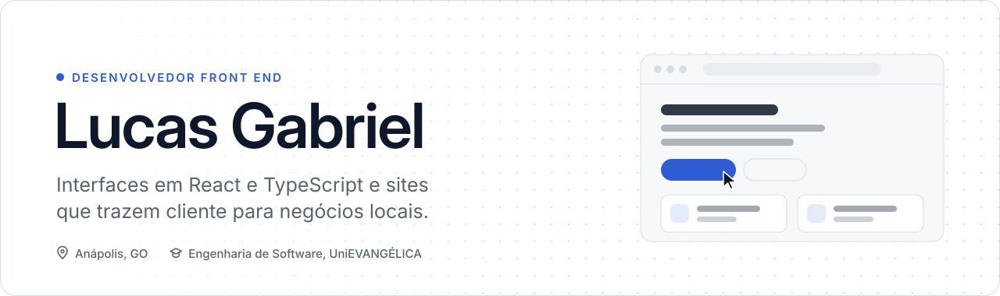
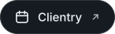
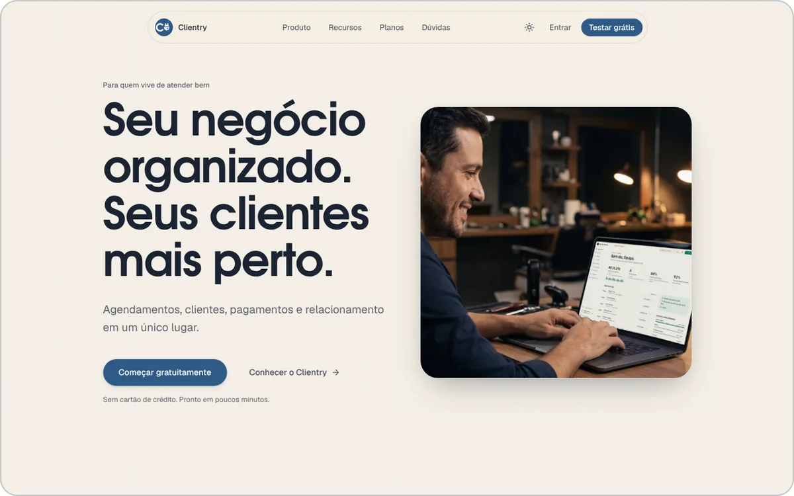
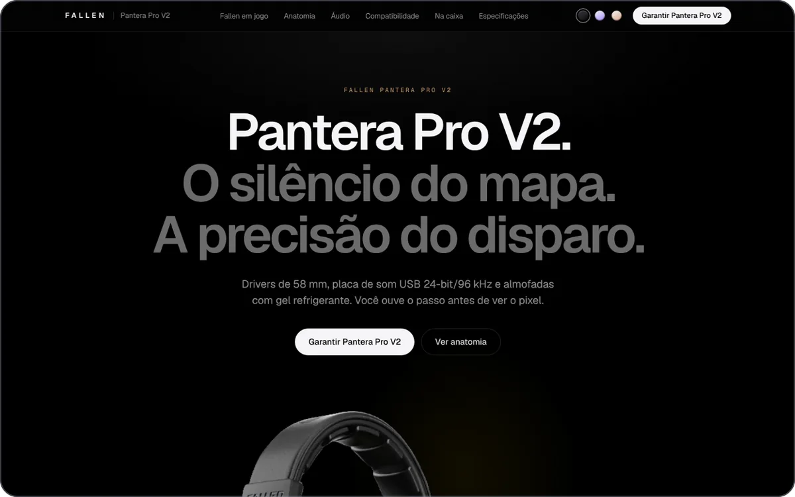
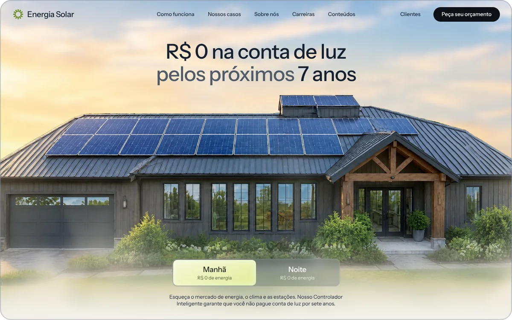
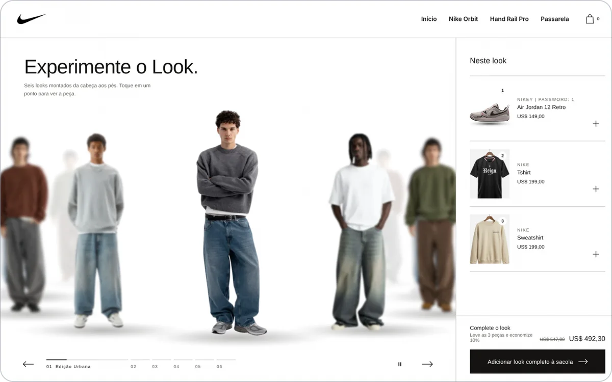

<picture>
  <source media="(prefers-color-scheme: dark)" srcset="assets/header-dark.svg">
  
</picture>

 

  &nbsp;
  &nbsp;
  &nbsp;
  

 

<picture>
  <source media="(prefers-color-scheme: dark)" srcset="assets/section-sobre-dark.svg">
  
</picture>

Trabalho com front end: interface, componentes, responsividade e a experiência de quem usa. Hoje meu foco está em duas frentes: telas de SaaS para pequenos negócios de serviço e sites que trazem cliente pelo WhatsApp e pelo Google para o comércio da minha região.

Gosto de interface que chega em produção testada, acessível e rápida no celular. Parte do código fica em repositórios privados porque é produto comercial ou trabalho de cliente; abaixo está o que cada projeto faz e como foi construído.

**Atualmente:** auxiliar de programação, no desenvolvimento e manutenção de software, e auxiliar administrativo.

 

<picture>
  <source media="(prefers-color-scheme: dark)" srcset="assets/section-projetos-dark.svg">
  
</picture>

<table>
<tr>
<td width="50%" valign="top">

### [Clientry](https://clientry.com.br)
SaaS de agenda, clientes e pagamentos para barbearias, salões, estúdios e clínicas.

- Agenda com visões de dia, semana e mês, por profissional
- Prévia interativa do produto na página inicial, em abas
- Tema claro e escuro, pensado primeiro para o celular

`Next.js 16` `React 19` `TypeScript` `Zod` `Vitest` `Playwright` · código privado

</td>
<td width="50%" valign="top">

### [Fallen Pantera Pro V2](https://fallen-pantera.vercel.app)
Página de produto e filme de 45 s para um headset gamer, com o mesmo kit de marca nos dois.

- Vista explodida interativa e diagrama polar dos microfones
- Visualizador de crosstalk em canvas
- Filme em Remotion a 1080p/60 fps, roteiro versionado em JSON

`React 19` `Tailwind CSS 4` `Framer Motion` `Remotion`

</td>
</tr>
<tr>
<td width="50%" valign="top">

### [Energia Solar](https://energia-solar-ruddy-kappa.vercel.app)
Landing page de energia solar residencial, com a cena do telhado mudando entre manhã e noite.

- Alternância manhã/noite que troca a cena e as cores da página
- Animações com `requestAnimationFrame` e `IntersectionObserver`
- Banner de cookies e páginas de privacidade e termos

`HTML` `CSS` `JavaScript`

</td>
<td width="50%" valign="top">

### [Loja da Nike](https://loja-da-nike.vercel.app)
Vitrine "Experimente o Look": uma passarela com seis looks completos, da cabeça aos pés.

- Carrossel de looks com arraste, setas e reprodução automática
- Pontos clicáveis em cada peça, ligados à lista "Neste look"
- Sacola de estilo, com produtos de uma loja Shopify de testes

`HTML` `CSS` `JavaScript` `Shopify` · conceito não oficial, sem vínculo com a Nike

</td>
</tr>
</table>

 

<picture>
  <source media="(prefers-color-scheme: dark)" srcset="assets/section-outros-dark.svg">
  
</picture>

| Projeto | O que é |
| :-- | :-- |
| [**Oben Place**](https://oben-place.vercel.app) | Hamburgueria em Anápolis, com cardápio e pedidos online |
| [**Mel Nativo**](https://mel-jatai.vercel.app) | Loja e guia de méis de abelhas nativas |
| [**Mahi 3D Printing**](https://mahi-printing.vercel.app) | Impressão 3D sob medida (EUA) |
| [**Chaveiro City**](https://chaveirocity.vercel.app) | Chaveiro residencial, comercial e automotivo |
| [**CraftGuess**](https://fast-vega-cpqi9w3.vercel.app) | Quiz sobre Minecraft, com modos, ranking e conquistas |
| **KindUP** | Plataforma de doações com perfis de doador, instituição e administração (projeto acadêmico, privado) |

 

<picture>
  <source media="(prefers-color-scheme: dark)" srcset="assets/section-stack-dark.svg">
  
</picture>

<picture>
  <source media="(prefers-color-scheme: dark)" srcset="https://skillicons.dev/icons?i=ts,js,html,css,react,nextjs,tailwind,vite&perline=8">
  
</picture>
 
<picture>
  <source media="(prefers-color-scheme: dark)" srcset="https://skillicons.dev/icons?i=vitest,figma,git,github,vercel,netlify,vscode,linux&perline=8">
  
</picture>
  
<picture>
  <source media="(prefers-color-scheme: dark)" srcset="assets/chips-dark.svg">
  
</picture>

 

<picture>
  <source media="(prefers-color-scheme: dark)" srcset="assets/section-processo-dark.svg">
  
</picture>

| Princípio | Na prática |
| :-- | :-- |
| **Componentes antes de telas** | Interface montada com componentes reutilizáveis, com estados de carregamento, vazio e erro pensados desde o início. |
| **Tipos nos formulários** | TypeScript estrito e Zod em toda entrada que vem do usuário. |
| **Teste antes de publicar** | Vitest para componentes e lógica de tela, Playwright para os fluxos principais. |
| **Acessível e leve** | Mobile first, contraste e foco visíveis, `prefers-reduced-motion` respeitado. |
| **Nada inventado** | Preço, depoimento, horário ou número de cliente só entra no site se for real e confirmado. |

 

<picture>
  <source media="(prefers-color-scheme: dark)" srcset="assets/section-contato-dark.svg">
  
</picture>

Orçamentos, parcerias e projetos: pelo [portfólio](https://lucgabdev.vercel.app) ou no Discord **@lucgabdev**.
