## Sobre

Sou Lucas Gabriel, de Anápolis (GO), estudante de Engenharia de Software na UniEVANGÉLICA. Crio produtos digitais completos, como sites, landing pages, sistemas web e plataformas SaaS, do planejamento à publicação.

Programo com React, Next.js, TypeScript e Tailwind CSS, com foco em interfaces rápidas, responsivas e acessíveis. Gosto de games e de interface com personalidade, e isso aparece no que faço: do Clientry ao CraftGuess, meu quiz de Minecraft. Também desenho identidades visuais e edito vídeo e motion.

**Agora:** evoluindo o Clientry, criando sites para negócios locais, desenhando identidades visuais e editando vídeo.

## Destaques

<table>
<tr>
<td width="50%" valign="top">

### [Clientry](https://clientry.com.br)
SAAS · NO AR

Agenda, clientes e pagamentos para quem atende com hora marcada: barbearias, salões, estúdios e clínicas.

- Multi-tenant: toda consulta é filtrada pela organização no serviço, nunca na tela
- Agendamento público, CRM, financeiro, automações por cron e cobrança de planos via Mercado Pago, com tokens dos negócios cifrados
- Login por senha (scrypt) ou código por e-mail, com dispositivos confiáveis
- Conta de demonstração isolada por visitante e removida automaticamente

`Next.js 16` `React 19` `TypeScript` `Drizzle` `PostgreSQL` `Zod` `Vitest` `Playwright`

Código privado · produto comercial

</td>
<td width="50%" valign="top">

### [Kovex](https://kovexteam.vercel.app)
SOFTWARE SOB MEDIDA · NO AR

Site da Kovex, de software sob medida. Ao rolar a página, um notebook se abre e mostra uma conversa com o cliente virando projeto.

`Animação de rolagem` `Landing page` `Marca`

</td>
</tr>
</table>

## Projetos

<table>
<tr>
<td width="50%" valign="top">

### [CraftGuess](https://fast-vega-cpqi9w3.vercel.app)
WEB GAME

Quiz de Minecraft com modos de jogo, desafios diários, ranking e conquistas salvas no aparelho.

`Web app` `Gamificação` `UI/UX`

</td>
<td width="50%" valign="top">

### [Fallen Pantera Pro V2](https://fallen-pantera.vercel.app)
PÁGINA DE PRODUTO

Lançamento de headset gamer com vista explodida interativa, diagrama polar dos microfones e um filme de 45 s em Remotion (1080p/60 fps), num monorepo que compartilha o kit de marca entre site e vídeo.

`React 19` `Tailwind CSS 4` `Framer Motion` `Remotion`

</td>
</tr>
<tr>
<td width="50%" valign="top">

### [Energia Solar Regional](https://energia-solar-regional.vercel.app)
ENERGIA SOLAR

Landing page com a cena do topo alternando entre manhã e noite, seções de economia e pedido de orçamento direto.

`HTML` `CSS` `JavaScript` `IntersectionObserver`

</td>
<td width="50%" valign="top">

### [Lume Vidros](https://vidraceria.vercel.app)
NEGÓCIO LOCAL

Vidraçaria e esquadrias de alumínio, com serviços, depoimentos e orçamento direto pelo WhatsApp.

`Landing page` `WhatsApp` `Responsivo`

</td>
</tr>
<tr>
<td width="50%" valign="top">

### [Lume Burger](https://template-hamburgueria-steel.vercel.app)
HAMBURGUERIA

Cardápio por categoria, busca, promoções e pedido finalizado pelo WhatsApp.

`Cardápio` `Promoções` `WhatsApp`

</td>
<td width="50%" valign="top">

### [Mel Nativo](https://mel-jatai.vercel.app)
LOJA E GUIA

Loja e guia de méis de abelhas nativas, com identidade forte e tipografia de impacto.

`Identidade visual` `Loja`

</td>
</tr>
<tr>
<td width="50%" valign="top">

### [Blumenau](https://blumenau.vercel.app)
GUIA VISUAL

Guia visual da cidade, com pontos turísticos, Oktoberfest e roteiro.

`Direção de arte` `Editorial`

</td>
<td width="50%" valign="top">

### [Mahi 3D Printing](https://mahi-printing.vercel.app)
SERVIÇO SOB MEDIDA

Impressão 3D personalizada nos EUA, com galeria e pedidos pelo WhatsApp. Site em inglês.

`Landing page` `Inglês` `WhatsApp`

</td>
</tr>
</table>

### Mais projetos

| Projeto | O que é |
| --- | --- |
| KindUP | Plataforma de doações com perfis de doador, instituição e administração, fluxo da doação como máquina de estados e LGPD (Next.js 15, Prisma, PostgreSQL). Código privado, projeto acadêmico |
| [Loja da Nike](https://loja-da-nike.vercel.app) | Vitrine "Experimente o Look" com passarela de seis looks e produtos de uma loja Shopify de testes. Conceito não oficial, sem vínculo com a Nike |
| [Oben Place](https://oben-place.vercel.app) | Hamburgueria em Anápolis, com cardápio e pedidos online |
| [Chaveiro City](https://chaveirocity.vercel.app) | Chaveiro residencial, comercial e automotivo |

## Stack

**Código** 

**Ferramentas** 

**Design:** UI/UX, identidade visual, vetorização, design systems 
**Vídeo:** motion design, cortes e edição

## Como eu trabalho

- **Componentes antes de telas.** Estados de carregamento, vazio e erro pensados desde o início.
- **Tipos e validação.** TypeScript estrito e Zod em toda entrada que vem do usuário.
- **Teste antes de publicar.** Vitest na lógica de tela e Playwright nos fluxos principais.
- **Acessível e leve.** Mobile first, contraste e foco visíveis, `prefers-reduced-motion` respeitado.
- **Nada inventado.** Preço, depoimento, horário ou número de cliente só entra no site se for real e confirmado.

## Contato

Tem um projeto, um sistema para organizar ou uma marca para criar? Me chame no canal que preferir.

[WhatsApp (62) 99192-0407](https://wa.me/5562991920407?text=Ol%C3%A1%2C%20Lucas!%20Vim%20pelo%20seu%20GitHub.) · [Portfólio](https://lucgabdev.vercel.app) · Discord **@lucgabdev_**
